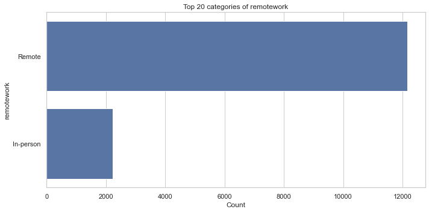
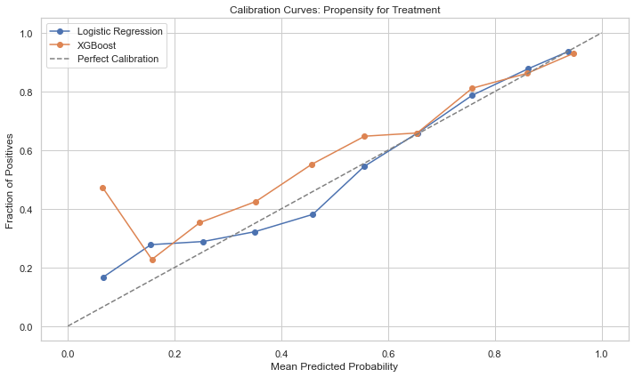
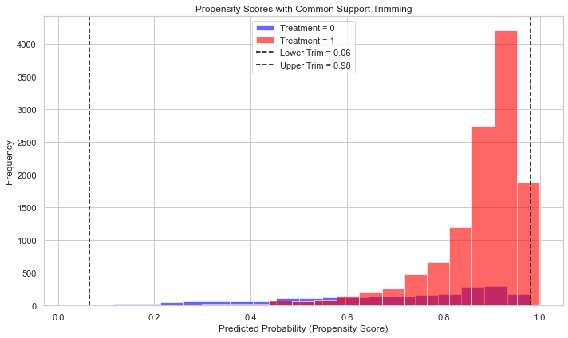

# Does Remote Work Causally Affect Developer Salaries?

A causal inference study on U.S. software developers using the Stack Overflow Annual Developer Surveys (2022–2024).

**Authors:** Yuval Margolin, Daniel Maor

> **Causal question:** Does working fully remotely, compared with working fully in-person, causally affect total annual compensation for software developers in the United States?

| | |
|---|---|
| **Treatment** (`T = 1`) | Fully remote work |
| **Control** (`T = 0`) | Fully in-person work (hybrid workers are excluded) |
| **Outcome** (`Y`) | Total annual compensation in USD (`ConvertedCompYearly`) |
| **Population** | U.S.-based respondents to the 2022, 2023 and 2024 surveys |
| **Estimand** | Average Treatment Effect (ATE) |

---

## Repository contents

| File | Description |
|---|---|
| `Causal_Inference_Project.ipynb` | Full analysis notebook: data prep, imputation, propensity scores, trimming, T-/S-/IPW-S-learners, placebo tests |
| `Causal_Inference_Project_Report.pdf` | Written project report (literature, DAG, assumptions, results and discussion) |
| `Statement on ChatGPT Usage.pdf` | Disclosure of how AI tools were used |
| `figures/` | Key plots exported from the notebook |
| `requirements.txt` | Python dependencies |

### Data (not included)

The raw survey files are 100–160 MB each, which is over GitHub's file size limit, so they are not in the repository. Download the public survey results from <https://survey.stackoverflow.co/> and put them in the repository root under these names:

| Survey year | Expected file name |
|---|---|
| 2022 | `results2022.csv` |
| 2023 | `survey_results_public2023.csv` |
| 2024 | `Stack Overflow Annual Developer Survey2024.csv` |

(Each one is the `survey_results_public.csv` file from that year's zip, renamed.)

---

## Process

### 1. Data loading and harmonization
- Loaded the three yearly surveys, normalized the column names (lowercase, no spaces or underscores), added a `year` column, and concatenated them with an outer join.
- Kept only respondents whose country is `United States of America`, leaving **43,285 rows**.
- Kept the relevant columns: `remotework`, `workexp`, `convertedcompyearly`, `age`, `employment`, `edlevel`, `yearscode`, `yearscodepro`, `devtype`, `orgsize`, `industry`, `country`, `year`.

### 2. Imputing `industry` for 2022
The 2022 survey has no `Industry` question. Industry is an important confounder, and dropping all of 2022 was undesirable, so a **Random Forest classifier** (300 trees) was trained on the rows where industry is known (label-encoded features, 70/30 stratified split). It reached **97.1% validation accuracy**, with weaker recall on small classes such as Energy, Legal Services, and Oil & Gas. The model then predicted the missing industries.

### 3. Cleaning and treatment definition
- Experience strings were converted to numbers (`"Less than 1 year"` → 0.5, `"More than 50 years"` → 51).
- `remotework` was harmonized across years (`Remote` / `Fully remote` → **Remote**, `In-person` / `Full in-person` → **In-person**). Hybrid respondents map to missing and are dropped.
- Rows with a missing confounder or missing treatment were dropped, leaving **14,389 rows** (≈ 85% remote, 15% in-person).
- A helper flag `senior_dev = 1` was added for respondents with `yearscodepro ≥ 5`.

<p align="center"></p>

### 4. Propensity score model, calibration, and trimming
- **Confounders (X):** `age`, `employment`, `edlevel`, `devtype`, `orgsize`, `industry`, `workexp`, `yearscode`, `yearscodepro`
- Two candidate propensity models were compared on a 30% validation split: Logistic Regression (`LogisticRegressionCV`) and XGBoost. Categorical features were one-hot encoded.
- **Model selection by Brier score:** Logistic Regression 0.1059 vs. XGBoost 0.1105, so **Logistic Regression** was selected (calibration curve below).
- **Common-support trimming:** units with propensity scores outside `[max(min p | T), min(max p | T)]` = **[0.065, 0.981]** were removed. **14,173 / 14,389** rows were kept (1.5% dropped).

<p align="center">
  
  
</p>

### 5. Effect estimation
The trimmed data was split 70/30 into train and validation sets. Rows with a missing salary were then dropped, leaving 8,150 train rows and 3,433 validation rows. The ATE is computed on the validation set. Three meta-learners were used:

| Method | How it works | Candidate outcome models (selected by validation RMSE) |
|---|---|---|
| **T-learner** | Fits separate outcome models for treated and control. ATE = mean(μ̂₁(x) − μ̂₀(x)) | Linear Regression, Gradient Boosting, Random Forest |
| **S-learner** | Fits one model with `T` as a feature, predicts with T = 1 and T = 0, and averages the difference | Linear, Gradient Boosting, XGBoost, Random Forest, Lasso (α ∈ {0.05, 0.1, 0.2}), Ridge (α ∈ {0.1, 1, 10}) |
| **IPW-weighted S-learner** | Same as the S-learner, but the outcome model is trained with inverse-propensity weights `w = T/e(x) + (1−T)/(1−e(x))`, with `e(x)` clipped to [0.01, 0.99] | HistGradientBoosting, Random Forest, Ridge, Lasso (3-fold weighted CV RMSE) |

95% confidence intervals use the percentile bootstrap: 2,000 resamples for the T- and S-learner, and 1,000 for the IPW S-learner.

### 6. Robustness checks
- **Subsets:** the full pipeline (propensity → trimming → learners) was repeated on (a) 2023–2024 only (no imputed industry), (b) junior developers (< 5 years of professional coding), and (c) senior developers (≥ 5 years).
- **Placebo tests:** the IPW S-learner was re-run with pre-treatment variables that remote work cannot affect as fake outcomes: education level, age, years coding, org size, and dev type.

---

## Results

### Main results (full 2022–2024 sample, after trimming)

| Method | Selected outcome model(s) | ATE (USD / year) | 95% CI |
|---|---|---:|---|
| T-learner | GradientBoosting (T=1), RandomForest (T=0) | **$63,355** | [$58,047, $69,168] |
| S-learner | Ridge (α = 10) | **$36,726** | [$10,902, $61,622] |
| IPW-weighted S-learner | Ridge (α = 1) | **$29,101** | [$5,483, $51,560] |

All three methods estimate a **positive and statistically significant** remote-work premium, but its size depends on the method: the T-learner's estimate is about twice the IPW S-learner's.

### Robustness: subsets

| Subset | Rows kept after trimming | Propensity Brier (LR / XGB) | T-learner ATE [95% CI] | IPW S-learner ATE [95% CI] |
|---|---|---|---|---|
| 2023–2024 only | 9,545 / 9,702 | 0.1194 / 0.1288 | $8,874 [$6,688, $11,006] | $4,361 [−$362, $12,576] |
| Junior (< 5 yrs pro) | 2,796 / 2,822 | 0.1710 / 0.1782 | $67,399 [$53,234, $82,330] | $21,807 [−$26,941, $59,333] |
| Senior (≥ 5 yrs pro) | 11,424 / 11,567 | 0.1000 / 0.1068 | $37,456 [$32,122, $44,725] | $34,022 [$13,007, $52,927] |

(The subset numbers come from the written report. The notebook in this repo shows the outputs for the full sample. To get a subset, change the dataframe passed to `propensity_model_selection` in the cell under the heading "here switch Data freme for subset".)

### Robustness: placebo outcomes (IPW S-learner, label-encoded outcomes)

| Placebo outcome | ATE | 95% CI | approx. p-value |
|---|---:|---|---:|
| `edlevel` | 0.00036 | [0.00012, 0.00069] | 0.015 |
| `age` | −0.00004 | [−0.00043, 0.00055] | 0.87 |
| `yearscode` | 0.00005 | [−0.00007, 0.00015] | 0.38 |
| `orgsize` | −0.00006 | [−0.00035, 0.00066] | 0.80 |
| `devtype` | 1.02 | [−0.047, 1.356] | 0.004 |

`age`, `yearscode` and `orgsize` show no effect, as expected. The `edlevel` effect is tiny in magnitude but its CI does not include zero. The `devtype` estimate has a normal-approximation p-value < 0.05 even though its percentile CI includes zero (the bootstrap distribution is skewed). Read these two with some caution (see the notes below).

### Interpretation
- **Direction:** every method and subset gives a positive point estimate for the remote-work premium.
- **Magnitude:** the estimate is sensitive to the method and the sample, ranging from about $4k to $9k (2023–2024) up to about $29k to $63k (full sample).
- **Most credible for senior developers:** both methods agree (about $34k to $37k), and both CIs exclude zero.
- **Junior developers and 2023–2024:** the results are less stable. The IPW S-learner CIs include zero, and the T-learner and IPW S-learner estimates differ a lot.
- The premium seems to have **shrunk in recent years**. The 2023–2024 estimate (about 10–15% of a typical developer salary) is in line with the roughly 13% premium found in BLS research on the wider U.S. workforce.

Overall, the evidence suggests that fully remote developers earn more than observationally similar in-office developers. The exact causal size of the premium is uncertain.

---

## Assumptions

### Causal (identification) assumptions
1. **Causal direction / timing:** remote status is determined before, or at the same time as, salary, so salary does not cause remote status. Work arrangements are usually agreed when the role is defined.
2. **SUTVA:**
   - *No interference:* one developer's salary does not depend on coworkers' work arrangements beyond what company size and industry already capture. The sample covers many different companies.
   - *No hidden versions of treatment:* treatment is strictly binary (fully remote vs. fully in-person), and hybrid workers are excluded.
3. **Consistency:** the reported salary under the reported work mode equals the potential outcome under that mode. Both are reported together for the current job.
4. **Conditional ignorability (no unmeasured confounding):** given X = {experience (`workexp`, `yearscode`, `yearscodepro`), education, developer type, org size, industry, employment type, age}, remote status is independent of the potential salaries. This is encoded in the project's causal DAG (see the PDF report, Figure 1).
5. **Positivity / overlap:** every covariate profile has a non-zero probability of both remote and in-person work. This is checked with the propensity score distribution and enforced by trimming to common support.

### Modeling and data assumptions
- `industry` for 2022 respondents can be imputed well enough from the other survey answers with a Random Forest.
- U.S.-only restriction: this avoids cross-country differences in pay and purchasing power, and it makes `country` a constant.
- Dropping rows with a missing confounder or treatment does not introduce selection bias (missing at random).
- Experience categories can be converted to numbers (`<1 year` → 0.5, `>50 years` → 51).
- Logistic regression gives well-calibrated propensity scores (lowest Brier score).
- Clipping propensities to [0.01, 0.99] in the IPW step controls variance at the cost of a little bias.
- Survey responses are truthful, and Stack Overflow respondents are representative enough of U.S. developers. The sample is self-selected, not random.

---

## Limitations
- **Unmeasured confounding** is the main threat. Unobserved skill, negotiating power, or being "indispensable" may lead to both remote arrangements and higher pay, which would bias the estimates upward.
- **Treatment imbalance:** about 85% of the sample is remote vs. 15% in-person, so there are relatively few controls, and subgroups may need extrapolation.
- **Heavy-tailed outcome:** salaries go up to $35M. No outlier handling or log transform was applied, so validation RMSEs are large ($340k–$680k) and a few extreme values can move the ATE.
- **Model selection on the same validation data** used to compute the ATE can bias the estimates somewhat.
- **Scope:** U.S. developers in the pandemic and post-pandemic period, with hybrid workers excluded.

### Notes on the code (for anyone reusing it)
- **Imputation leakage:** `feature_cols` in the industry-imputation cell includes `industry` itself, so the reported 97.1% accuracy is measured with the target among the features. For 2022 rows that feature is missing, so the real accuracy of the imputed values is unknown and probably lower. The outcome (`convertedcompyearly`) is also a feature in that model. Removing `industry`, `year`, and the outcome from the imputation features would give a fair accuracy estimate. The 2023–2024 robustness check, which uses no imputed data, is useful for exactly this reason.
- **T-learner CI:** the T-learner bootstrap resamples the validation-set *predictions* without refitting the models. This captures only part of the uncertainty, so its CI is narrower than those of the S-learner and IPW S-learner, which refit on every resample.
- **Placebo design:** the placebo outcomes are themselves in X and are label-encoded as arbitrary integer codes. A near-zero ATE is therefore partly mechanical, and the test is weaker evidence than it looks.
- **Execution order:** the notebook cells were run out of order (see the execution counts), and some intermediate state, such as the 14,389-row `df_completed`, came from cells that are no longer in the notebook. A clean top-to-bottom run may give slightly different numbers.

---

## Reproducing

```bash
python -m venv venv
source venv/bin/activate          # Windows: venv\Scripts\activate
pip install -r requirements.txt
# put the three survey CSVs in the repo root (see "Data" above)
jupyter notebook Causal_Inference_Project.ipynb
```

The analysis was run with Python 3.10. `scikit-learn < 1.6` is needed because the code passes `fit_params` to `cross_val_score`.

## References
1. U.S. Bureau of Labor Statistics, *Remote Work, Wages, and Hours Worked in the United States*, 2024.
2. J. M. Barrero, N. Bloom, S. J. Davis, B. Meyer, E. Mihaylov, *The Shift to Remote Work Lessens Wage-Growth Pressures*, Becker Friedman Institute, 2022.
3. Stack Overflow Annual Developer Survey, 2022–2024. <https://survey.stackoverflow.co/>

## AI usage
ChatGPT was used for writing support, debugging, and clarifying concepts. All decisions about data, models, methods, and interpretation were made by the authors. See `Statement on ChatGPT Usage.pdf`.
